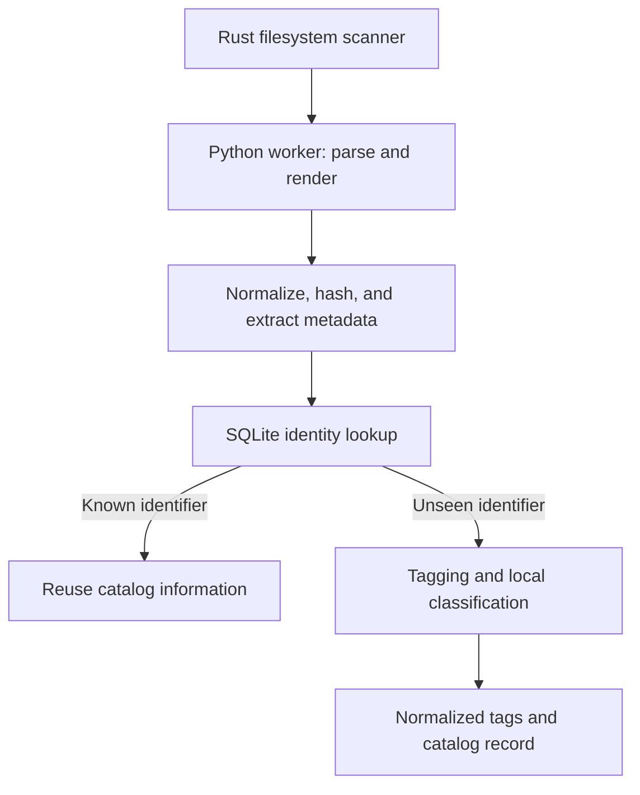

# Project Diamond

**Content-based identification, metadata extraction, and AI tagging for embroidery design files.**

Project Diamond is my Ohio State University master's project: a prototype cataloging engine that makes collections of proprietary embroidery files searchable and recognizes matching artwork across file formats.

**Document scope:** a historical portfolio case study based on the supplied project reports. This page documents the reported prototype and evaluation; it is not a verification of the current repository implementation. See the [repository README](../../README.md) for source layout and setup.

## The problem

Embroidery designs contain machine instructions rather than ordinary images. Proprietary formats and short machine filenames make large collections difficult to preview, organize, and search. Byte-level hashes also treat the same artwork exported in different formats as unrelated files.

## My contribution

I designed and implemented the Rust/Python processing pipeline, evaluated content-based identification, integrated multiple image-recognition engines, trained a craft-category classifier, and documented runtime, cost, and deployment tradeoffs.

- Rust filesystem scanner and SQLite cache with a typed JSON bridge to a Python worker.
- Stitch-only rendering, normalized previews, perceptual hashing, and deterministic UUIDv5 identifiers.
- Extraction of dimensions, stitch count, and thread-color count.
- Semantic tagging with Gemini 2.5 Pro, Gemini Flash, and Clarifai, plus an EfficientNetB0 classifier exported to ONNX for local inference.
- Concurrent engine calls and reasoning-budget control to reduce tagging latency.
- A Python prototype for finding product images in static HTML and processing image bytes in memory.

## Architecture

This summarizes the prototype and intended catalog workflow. The partner cloud database and customer-facing application were outside my implementation scope.

## Reported evaluation

| Measure | Result | Qualification |
| --- | --- | --- |
| Evaluation corpus | 347 files | Small-corpus validation; no million-image benchmark |
| Sequential tagging runtime | Over 5 hours | Reported project measurement |
| Concurrent tagging with reasoning-budget control | Approximately 35–50 minutes | Both changes contributed to the improvement |
| Pairwise identity analysis | 60,031 pairs | All unordered pairs among 347 renders |
| Proposed tolerance | At most 7 differing bits in a 256-bit hash | Corpus-specific recommendation; integration status differs between reports |

Measurements are summarized from project reports and were not rerun while preparing this case study. Final classifier accuracy and corrected per-image costs were not supplied in the master report and are therefore not claimed here.

## Technical decisions

**Visual identity:** hash normalized rendered content rather than source-file bytes. UUIDv5 encodes an exact hash deterministically; it does not itself provide approximate matching or guarantee that distinct artwork cannot collide.

**Stitch-only rendering:** draw stitches and break line continuity at machine-control commands to avoid format-specific artifacts.

**Local processing:** identify designs and extract metadata locally, with the intended catalog lookup gating cloud enrichment for unseen designs.

**Deployment consistency:** preserve the trained classifier's preprocessing contract when exporting to ONNX, including resize behavior and input value range.

## Coverage and limitations

The reported active formats are PES, DST, EXP, JEF, VP3, and HUS. VIP and ART were descoped; a conversion-service prototype was built but was not active coverage.

Cross-format identity worked for evaluated examples, with remaining format drift and orientation cases. Rotation invariance was a requirement and an open engineering item in the master report. A separate threshold report describes later fixes, but code and regression results were not audited while preparing this case study. Approximate matching must be resolved through a registry/cache policy rather than by comparing UUID strings.

Production-scale collision rates, classifier accuracy, and current API costs remain unverified. See [evaluation notes](docs/evaluation.md).

## Documentation

- [Architecture and design decisions](docs/architecture.md)
- [Evaluation and evidence limits](docs/evaluation.md)

## Author

[Aman Hafez](https://github.com/amanhaf) · Master of Science project, The Ohio State University · 2026

## Availability

This portfolio summary omits original partner documents, proprietary designs, source code, model weights, and credentials. This documentation does not change the licensing of repository source or partner materials.
